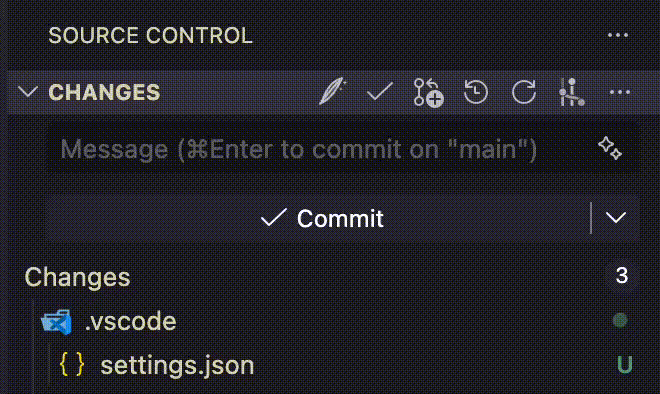

# AI Commit Message Gen

AI Commit Message Gen is a VS Code extension for generating Git commit messages with AI directly inside the Source Control view. It creates clean [Conventional Commits](https://www.conventionalcommits.org/) and works as a configurable alternative to the built-in commit message generator.

If you want an AI commit message generator for VS Code that supports multiple providers and models, this extension is built for that workflow.

Already working with a coding agent? It can put the commit message it writes into the same message box, with no API key. See [Commit Messages from Your Coding Agent](#commit-messages-from-your-coding-agent).

## AI Commit Message Generator for VS Code

Generate commit messages in VS Code without leaving your editor:

1. Stage your changes in the Source Control view.
2. Click the feather button in the Source Control title bar.
3. The extension writes an AI-generated commit message into the commit input box.

<p align="center">
  
</p>

On first use, the extension prompts you for an API key for the currently selected model provider.

## Why Use This Extension

- Generate Git commit messages with AI inside VS Code.
- Produce consistent Conventional Commit messages.
- Choose from multiple AI providers and models.
- Replace the default VS Code commit message generator with a more effective option.
- Let your coding agent (Claude Code, Cursor, Codex, and others) put its own commit message in the message box, with no API key needed.
- Keep API keys secure with VS Code SecretStorage.

## Supported AI Models

Use the commit message generator with models from Anthropic, OpenAI, Google, DeepSeek, and Mistral.

| Provider | Models |
| -------- | ------ |
| **Claude** (Anthropic) | Opus 5, Sonnet 5, Haiku 4.5 |
| **GPT** (OpenAI) | GPT-5.6 Sol, GPT-5.6 Terra, GPT-5.6 Luna |
| **Gemini** (Google) | 3.7 Flash, 3.1 Flash-Lite, 3.1 Pro (Preview) |
| **DeepSeek** | V4 Flash, V4 Pro |
| **Mistral** | Medium 3.5, Codestral |

## VS Code Commands

- `AI Commit: Set Model`
- `AI Commit: Set API Key`
- `AI Commit: Clear API Key`

Each provider uses its own API key. Keys are stored securely using VS Code SecretStorage. If no key is set for the selected provider, you will be prompted when you generate a commit message.

## Conventional Commit Format

Generated messages follow the Conventional Commits format:

```text
<type>(<scope>): <description>

[optional body]
```

Common commit types: `feat`, `fix`, `docs`, `refactor`, `test`, `chore`

## Commit Messages from Your Coding Agent

If you work with a coding agent (Claude Code, Cursor, Codex, Copilot, and so on), it can put the commit message it writes straight into the Source Control message box. You review the staged diff next to it and click Commit yourself.

### Set It Up

Paste this into your agent's instructions file (`CLAUDE.md`, `AGENTS.md`, Cursor rules, or wherever your agent keeps standing instructions). You do this once per project, or once globally:

````markdown
## Commit messages

When you write a commit message for my staged changes, also send it to my editor.
With `message` set to the full commit message, run:

```sh
f=$(git rev-parse --git-path COMMIT_MSG_DRAFT) &&
  printf '%s\n' "$message" > "$f.tmp" && mv "$f.tmp" "$f"
```

That puts the message in the Source Control message box of my editor.
Do not run `git commit`. I review the message there and commit myself.
````

Nothing else needs configuring. The next time your agent writes a commit message, it appears in the message box.

### What to Expect

- If the message box is empty, the agent's message appears in it and the Source Control view opens.
- If you have already typed something else, your text stays. A notification asks whether to replace it, and ignoring the notification keeps your text.
- The extension only fills the message box. It never commits, stages, or changes your repository.
- To turn this off, set `"commitMessageGen.draftFile.enabled": false`. It takes effect immediately.

<details>
<summary>How it works (for scripts and tool authors)</summary>

Anything that can write a file can hand over a message. The contract is one file:

- **Name and location:** `COMMIT_MSG_DRAFT` in the repository's git directory, at the path `git rev-parse --git-path COMMIT_MSG_DRAFT` prints. That path is also correct in linked worktrees and submodules. The file is never tracked and never shows in `git status`.
- **Write by rename:** write the message to `COMMIT_MSG_DRAFT.tmp`, then rename it to `COMMIT_MSG_DRAFT`, so the extension never reads a half-written file. The `.tmp` name is ignored.
- **Read once, then deleted:** the extension reads the file, deletes it, and puts the trimmed text in the message box of the repository it was written in. The content is plain UTF-8 text, used as the commit message as is.

Other details:

- A draft identical to the text already in the box does nothing. An empty draft is deleted and ignored.
- A draft written while the editor was closed, or while the setting was off, is used only if the message box is empty and the repository has staged changes. It is deleted either way, so an old draft never turns up later.
- Keyboard focus stays where it is unless `commitMessageGen.focusMessageBox` is on.
- While the setting is off, nothing is watched and draft files are left untouched.

</details>

## Tip: Keep the Generate Button Visible

By default, the Source Control title bar button appears on hover. To keep it pinned in VS Code, add this setting:

```json
"workbench.view.alwaysShowHeaderActions": true
```

## ⭐ If It Helps You

If this extension saves you time, consider leaving a rating on the VS Code Marketplace.

It helps other developers discover it.
